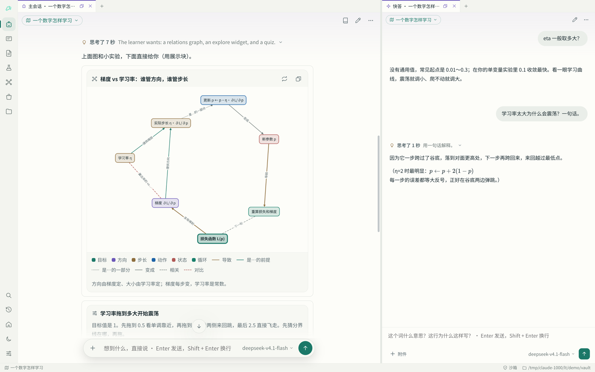
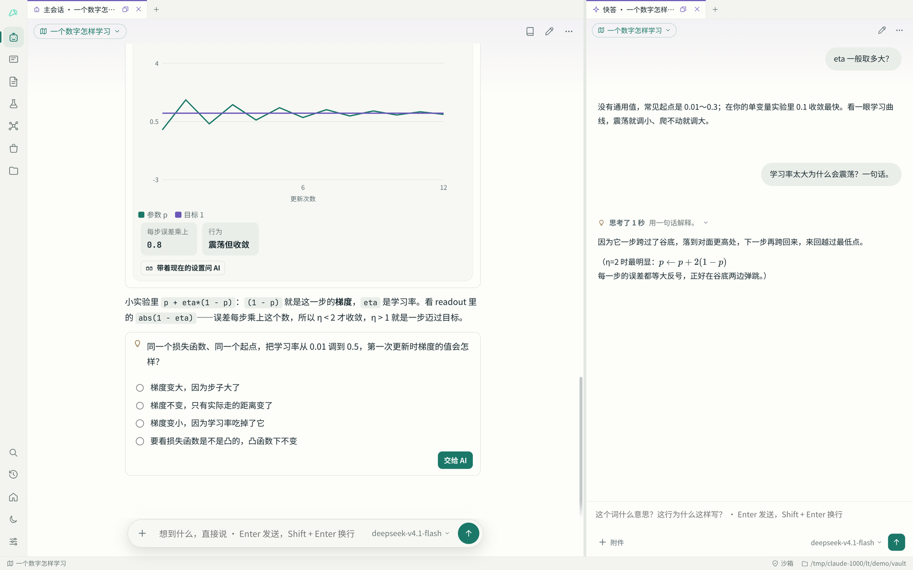
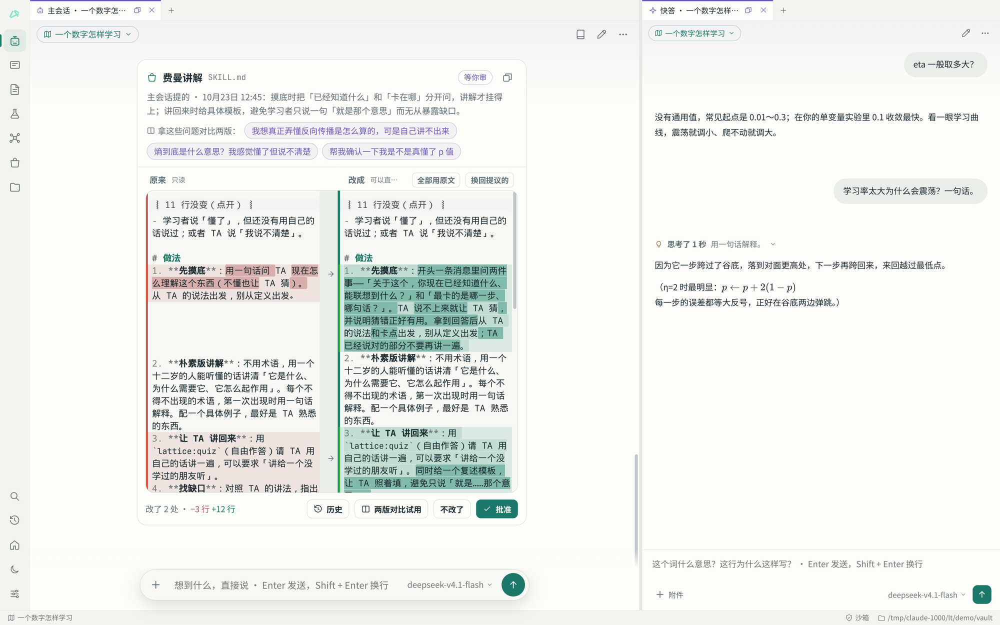
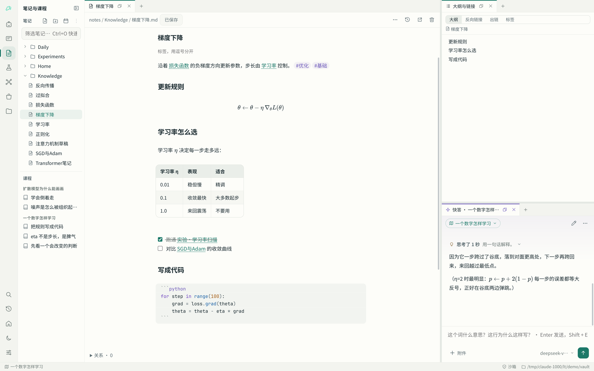
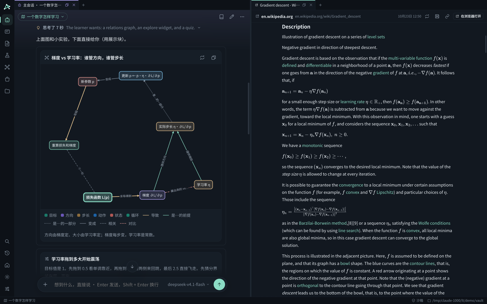

<div align="center">


# Lattice

**和 AI 一起学东西的本地学习工作台**

你和 AI 在同一个界面里学：它讲解、画图、出题、陪你做实验；你写笔记、跑代码、做卡片。<br>
所有学习数据都是你电脑上一个文件夹里的普通文件，用 git 记着每一步。

[](LICENSE)   

[快速开始](#快速开始) · [能做什么](#能做什么) · [截图](#截图) · [详细说明](#详细说明) · [设计文档](docs/DESIGN.md)

</div>



## 为什么做这个

学一个新东西，最难的往往不是找资料，而是没人陪你把它真正弄懂：讲到你能复述、在你卡住的地方停下来、让你动手试一下。Lattice 想做的是这样一个陪练——

- **不用先建课程**。想到什么就问，值得长期深入的，AI 自己建成主题、排出主干路线，岔出去的问题也能接回来；发现你哪块不熟，它自己在路线上补几站先讲。
- **AI 看得见你在做什么**。它知道你开着哪篇笔记、看到哪一节、选中了什么、实验跑出了什么，按你实际的进度讲，而不是从教材第一章开始。
- **东西都是你的**。笔记、卡片、对话、实验、轨迹都是普通的 Markdown、JSON 和 ipynb 文件，放在一个文件夹里，换工具、备份、自己改都行。

## 能做什么

| 功能 | 说明 |
|---|---|
| **两个 AI 分工** | 主会话负责讲，快答回答旁枝末节的小问题，不打断主讲；还有带你一步步写代码的练习教练、在后台整理笔记的整理助手，以及在后台给你做小应用的应用助手。 |
| **回复里能动手** | AI 当场画概念关系图、做能拖参数的小实验、出小题考你；代码块一点就运行，或者「拿到我这边」存成你的文件。 |
| **像 Obsidian 的笔记** | 实时预览、`[[双链]]`、反向链接、嵌入、标签、表格直接改、数学公式；代码编辑器有高亮、彩虹括号、补全；Jupyter 实验笔记。 |
| **知识卡和回顾** | 讲过的东西提炼成卡片，按理解阶段和到期时间回顾，记得住记不住都有记录。 |
| **技能** | 27 个讲解和生产的「做法」（费曼讲解、苏格拉底追问、教程树、论文精读……），可装、可改；AI 提议改技能时，你在回复里左右对照着审，还能用改前改后两版各答一次来比。 |
| **阅读器** | AI 引用的网页和 PDF 在旁边读，公式、表格、链接都在。 |
| **安全地跑代码** | AI 的命令和运行都在沙箱里（看不到家目录；能上互联网，连不了这台电脑和局域网）；需要显卡时按次唤醒，跑完就休眠。 |
| **模型随便接** | 二十多家预设服务（DeepSeek、OpenRouter、OpenAI、Anthropic、Gemini、Kimi、通义千问……）加本机 Ollama 等，也能完全自定义；思考强度可调，token 用量有统计。 |
| **界面随你** | 工作区自由搭、窗口拖动分栏浮出；颜色和风格可以自己调，也可以让 AI 设计一套主题。 |

## 截图

<table>
<tr>
<td width="50%"><br><sub>拖动学习率，看它收敛还是震荡；下面是一道小题。</sub></td>
<td width="50%"><br><sub>AI 提议改技能：删掉的标红、加上的标绿，批准了才生效。</sub></td>
</tr>
<tr>
<td width="50%"><br><sub>笔记：公式、表格、双链在编辑时就渲染好，右边是大纲与链接。</sub></td>
<td width="50%"><br><sub>深色主题：左边是关系图，右边在阅读器里读引用的网页。</sub></td>
</tr>
</table>

## 快速开始

Windows 上直接到 [Releases](https://github.com/vimalinx/lattice/releases) 下载安装包，见下面的 [Windows](#windows)。Linux 上从源码运行：

```bash
git clone https://github.com/vimalinx/lattice.git
cd lattice
pip install -r requirements.txt
python3 run.py
```

1. 打开设置的「模型连接」，左边选一家服务，右边贴上 API Key。
2. 回到对话，想学什么直接说。
3. 学习库默认在 `~/Lattice`，设置里可以换；想先看看效果，`python3 tests/seed_demo.py --launch` 会在 `/tmp/lattice-demo` 放一份演示数据并打开。

需要 Python 3.11+、PySide6（含 QtWebEngine）、jupyter_client、ipykernel、httpx、PyYAML、numpy、matplotlib；运行代码和 AI 沙箱另需 [`uv`](https://github.com/astral-sh/uv) 与 `bubblewrap`。编译型语言按需安装（gcc、rustc、go、node……），缺什么运行时会直接告诉你。目前主要在 Arch Linux / Wayland 上开发和测试。

### Windows

到 [Releases](https://github.com/vimalinx/lattice/releases) 下载 `Lattice-<版本>-setup.exe` 安装（装在你自己的用户目录下，不需要管理员权限），或者下载 zip 解压直接运行 `Lattice.exe`。安装包里带着 git 和 uv，不需要另外装 Python：第一次运行代码时 uv 会下载一份自己的 Python 来建学习库的环境。

安装包没有代码签名，第一次运行时 Windows 的 SmartScreen 会提示「Windows 已保护你的电脑」：点「更多信息」→「仍要运行」。装好后设置页左下角写着版本号，`Lattice.exe` 的文件属性里也有。

和 Linux 版的不同：

- **没有沙箱。** AI 的命令和运行用你的权限直接运行，能联网，也碰得到学习库以外的文件；它改动的学习库文件照样一步一步记进历史、可以撤销。状态栏显示「直接运行」。
- **AI 的命令用什么 shell。** 装了 Git for Windows 就用它带的 bash，否则用 PowerShell；AI 从界面信息里知道是哪一个，按它的写法写命令。运行器的命令在 `cmd` 里执行，`.sh` 文件需要 Git Bash。
- 显卡用驱动自带的 `nvidia-smi` 识别；Windows 上 PyPI 默认的 torch 只有 CPU 版，AI 会按显卡装 CUDA 版。
- 设置和日志在 `%APPDATA%\lattice`、`%LOCALAPPDATA%\lattice`，学习库默认还是用户目录下的 `Lattice`。

Windows 版由 GitHub Actions 构建（`.github/workflows/windows.yml`）：每次推到 main 都在 Windows 上跑测试、打包、真正启动一次打好的程序并截图（结果在 Actions 的 artifacts 里）；推一个 `v*` 标签就发布安装包和 zip。打包配置在 `packaging/`：`lattice.spec`（PyInstaller）和 `windows/lattice.iss`（Inno Setup）。

## 详细说明

### 界面

- 最左边的活动栏上每个图标是一个**工作区**：一套窗口组合，旁边的左栏放它自己的列表。点图标切换（Ctrl+1～9），再点一次当前的图标、点左栏右上角的收起按钮或按 Ctrl+B 收起这个工作区的左栏。默认有六个：
  - **对话**：主会话、快答和开始页，左栏是主题。这里什么都能放，AI 会按需要把别的工作区的窗口（卡片库、知识图、文件……）摆进来。
  - **知识卡**：卡片库（按阶段、主题、到期筛选和排序，点开一张看详情）、回顾、记忆（各理解阶段的卡、接下来两周每天到期多少、最近 30 天的回顾和老是记不住的卡），加快答。
  - **笔记与课程**、**实验与代码**（含练习和薄弱点）、**知识图**、**文件**：左栏是对应的列表，中间一块放打开的东西，旁边是快答或主会话。
- 同一个对话、同一个文件可以同时出现在几个工作区里，是同一个窗口：在知识卡里问快答，和在对话里问的是同一段对话。在一个工作区关掉标签只是把它拿出这个工作区。
- 自己搭工作区：任意一组标签末尾的「＋」里选「新工作区…」，或者右键活动栏上的图标——起名字、选图标、选左栏放哪些列表，照现在的样子复制或者从空白开始。右键还能改名、调顺序、隐藏、删除，以及「把现在的样子设为它的默认」和「恢复默认的样子」。设置的「工作区与左栏」里也能管。
- 工作区里的面板都能拖动标签换位置：拖到另一组的标签栏上合并成标签页；拖到某块区域上分栏：上下各四分之一处放到上面或下面，其余按左右两半放到左边或右边，拖的时候高亮框里写着会放到哪。标签上的按钮可以浮出成悬浮窗，悬浮窗上的「放回原处」让它回到原来那一组的原位置；拖动分隔条调整大小。悬浮窗标签上的按钮（或者右键标签）能把它放大成单独的系统窗口：可以最大化、拖到另一块屏幕，里面照常用，AI 照样看得到它在显示什么；点它标签栏上的「放回主窗口」或者直接关掉，面板回到主窗口里原来的地方（原来是悬浮窗就还是那个悬浮窗）；Lattice 关闭时还开着的，下次启动也回到原处。每个工作区的样子自动记住。活动栏底部是搜索（Ctrl+K，搜文档、文件、以往对话和命令）、学习轨迹、开始页、明暗和设置；最下面一条状态栏显示当前主题、谁在工作、沙箱状态。
- 每组标签末尾的「＋」：写记录、写代码（任何语言）、新实验笔记、新知识卡、新笔记，或者打开任何窗口（主会话、快答、开始、知识图、卡片库、回顾、记忆、大纲与链接、学习轨迹、设置），打开的东西就放进这一组；已经开在别处的窗口会挪过来。活动栏里默认不放「＋」，设置的「工作区与左栏」里可以打开，菜单是同一个。Ctrl+K 搜索文档、文件、以往对话和命令。
- 对话、笔记预览和卡片里的数学公式都用 KaTeX 渲染（打包在程序里，不联网）。
- 对话面板：AI 的回复是一栏限宽的正文，你的话在右侧气泡里；时间、复制、开始练习、存成卡片在鼠标移上去时出现。AI 做了哪些事折叠成一行，点开能查看或撤销。往上翻时右下角有「↓」回到最新。输入框一行时是胶囊，多行时变成圆角矩形；左边的「＋」附上学习库里的文件，或者从电脑里选文件（复制进 `data/附件/`，AI 也能读），右边可以只给这个窗口换模型。快答默认用普通输入框：上面一条细线，下面是附件、模型和发送；每个窗口都能在 ⋯ 菜单里换成胶囊或线条。还没开始聊时，输入框在中间，下面是接着学某个主题、回顾到期的卡、回到练习之类的起点。
- 回复中断了（点了停止、网络断了、接口报错、达到长度上限，或者程序中途关了）可以点「重新回答」：同一个问题再答一次，不会重复发问；没答完的那段留在记录里并标明「下面是重新回答的」，给模型看的历史里只留新的那次。
- 回复、笔记预览和嵌入里的代码块按语言高亮，用的是和编辑器同一套语法和配色。
- 模型的思考过程显示在回复上面，默认折叠成「思考了 N 秒」加一句摘要，点开看全文；正在思考时那一行滚动显示它最新想到的一句；展开后全文跟着最新一行走，往上翻就停在你翻到的地方，翻回底部再接着跟。设置里可以改成默认展开或不显示。
- 回答要连着用几轮工具（查学习库、算数、跑代码、搜资料）时，每轮前面它写一句接下来做什么，按顺序列在回答上方，你随时知道它走到了哪一步；答完折叠成「经过 N 步」。
- 对话右上角的「⋯」：这个窗口的大小、行距、阅读宽度；所有窗口的思考过程、字号、密度、明暗；以及开新会话、提炼知识卡、换模型、复制整段对话、存成笔记、浮出、关闭。
- 主题：颜色和风格都能改。设置「外观与交互」最上面是主题列表（默认、你存过的、AI 做的），可以换、可以删，下面能直接拾色改主要颜色；也可以直接跟 AI 说「换个暖一点的配色」「做个护眼主题」「圆角大一点」，它会设计一整套颜色（约 40 个颜色变量：底色、面板、文字、强调色、AI 色、代码高亮……）、字体和风格（圆角、阴影的 CSS）套上，存成有名字的主题；回复下的「还原界面」能撤回。主题里不能引用外部资源。右下角的明暗按钮在用自定义主题时会先回到默认外观。
- 大小：设置里调全局的字号、行距、阅读宽度（一行最多多少字，滑块调，或者不限）和每种窗口的默认比例；设置页里的改动都自动保存；某一个窗口可以单独调（鼠标放在上面 Ctrl + 滚轮，或者 Ctrl + = / Ctrl + - / Ctrl + 0，标签上右键也行），会跟着窗口记住。
- 新打开的东西不会盖住正在显示的对话：AI 打开文件、练习或别的窗口时，会放进别的组或者在对话旁边新分一栏，不会把主会话自己顶到后面去；藏在对话后面的标签被打开时也会挪出来。只有你在某一组的「＋」里选、或者自己拖过去时，才放进那一组。
- AI 也能控制整个界面：开关、摆放、浮出面板，换一种布局，切换或新建工作区，收起左栏，改外观。它每次动手都在回复下显示一行，点「还原界面」就回到它动手之前的样子。

### 和 AI 学

- 开始学一个新东西、而主会话还不清楚你的底子时，它先出一份两分钟的摸底问卷：几道问背景和目标、几道由浅入深的小题（都能选「不知道」），填完一起交回去，它据此在路线上标出你已经会的站、从起点开讲，背景记进「关于学习者」以后不再问。不想填就点「跳过，直接讲」；你已经说清了自己的水平就不出问卷。
- **读电子书**：PDF、EPUB、MOBI、AZW3、FB2、CBZ 都能直接打开（「＋」菜单的「打开电子书」会把书复制进学习库的 `books/`，学习库里的书点开就读）。PDF 保留原来的排版，文字能选中；其他格式能调字号、滚动或翻页。有目录和全书搜索，关掉再开回到上次的位置；选中一段就能问快答或主会话。书没打开时 AI 也能按页或按章读、能在全书里搜。书里的内容跑在和主界面隔开的地方，里面的脚本不会执行，也不联网。有 DRM 的书打不开；扫描版 PDF 没有文字层，你能看，AI 读不出字。
- **批注**：在书、笔记、代码、实验笔记、网页和对话里选中文字，就能高亮或写批注。所有批注都在「批注」窗口里，能搜索，点一下回到原处，也能做成带出处的知识卡。问 AI 时它知道选中的话出自哪里；AI 也能在原文旁留批注，你可以撤销。选中文字问快答后，那段话会变成带下划线的挂载点：快答关了也还在，点开就能看问答，也能放到右侧。批注是学习库 `annotations/` 下的普通文件。
- **把网页上和 AI 的对话接过来接着聊**：在 ChatGPT 里点对话右上角的「分享」→「复制链接」，把链接贴进主会话的输入框（或者用新建菜单、左栏「主题」上的导入按钮），看一眼读出来的标题和问答，点「导入并接着聊」。它成为当前主题下的一段主会话：你的提问和 ChatGPT 的回答原样保留（时间、公式，以及它的思考过程，折叠在回答上），结尾一条分隔线写着从哪导入；主会话知道前面是另一个 AI 说的，接住那边讲到的地方往下讲，那边讲错的会指出来。对话很长时，整理助手先给它存一份摘要，主会话看得到前面讲过什么。ChatGPT 回答里的交互小部件（能拖的滑块、能切换的选项、跟着变的图）在这里照样能用：Lattice 自带一个小的运行时，在隔离的小框架里运行它们，配色跟着 Lattice 的明暗；回答里的概念标注只留名词本身，引用标记去掉。现在支持 ChatGPT 的分享链接。
- 平时就在主会话那里想到什么说什么，不需要先建主题。值得长期深入的内容，主会话会自己建成主题或某条主线的分支，写下主干路线，把相关的对话一起带过去；它岔开、接回主干都会记进轨迹。
- 一个主题下可以开好几个主会话：左栏的主题下面直接列着它的会话（默认对话也一样），点主题就在它上次开着的那段会话里接着学，点正在学的主题收起或展开；会话能新建（主题行的「＋」）、切换、双击改名、归档和删除。每个会话都知道这个主题想弄懂什么、路线走到哪、其他会话在聊什么。
- 边学边记知识卡：主会话每讲完一段，整理助手在后台把讲到的概念、原理、方法和思想记成卡，分好类型和领域、连上已有的卡，记下的卡列在那条回复下面；卡片库按领域分组，能按类型筛。
- AI 记得住你，又不会把不同主题的东西搅在一起。关于你本人、换个主题也成立的事（你会什么、怎么学最顺、讲法上的好恶），AI 听出来就记进学习库的 `me.md`，每个 AI 每轮都读；记下的那一条显示在当时的回复下面，不认可点「撤销」，也可以直接改这个文件。只对某个主题成立的，记在那个主题的档案里。
- 离开一段主会话（切到别的主题或会话，或者 15 分钟没说话）时，整理助手在后台给它存档：这段会话聊到哪、你真正弄懂了什么、还卡在哪、下次从哪接（主题档案仍由主会话维护，存档不动它）。回来时主会话读存档接上，同一主题的其他会话也靠存档知道这里聊过什么；一段会话长到主会话看不全时，更早的部分也由存档补上。左栏会话的提示里能看到存档摘要。
- 每个 AI 的规则也能像技能一样改：AI 提出修改，你在对话里左右对照着审；有历史，能用两版规则各答一次来比。
- 主干路线标着你现在在哪一站。讲的过程中发现你对某块不熟（你在快答里问的基础问题、答错的小题、卡住的练习，主会话下一轮都看得到），它会自己记下这个薄弱点，在路线上补一两站先讲，并在回复开头说一句改了什么；补的站在路线和知识图上标着是为哪个薄弱点补的。补完、你会了，再接回主干。
- 每个 AI 都能读你的知识图、学习轨迹和你此刻的界面（开着什么、看到哪一节、选中了什么、有没有没保存的草稿），由它自己判断你在哪、该学什么、什么时候提议回到主干。发消息时附一行界面附注。
- **快答不属于哪个主题或会话**：在界面上任何地方有小问题都问它，换主题、换主会话，快答还是那一段（「新会话」按钮清空重来）。它不被塞满上下文：每条消息只带一份界面上开着的标签目录（主窗口各工作区的、浮出的、单独窗口里的，哪个在前台、哪个是你刚在用的）和你选中的文字；要看哪个标签，它自己用工具去读：笔记和代码的全文（连没保存的草稿）、实验笔记的单元格和输出、主会话的消息、阅读器里的网页、应用此刻的界面和每个控件的值、其他面板上显示的内容。主会话和练习教练也有这套工具。你在快答里问过什么，主会话下一轮照样看得到（按当时在学的主题算）。
- AI 的回复里可能有展示块：让你先预测或作答的题（答案记进轨迹）、一组知识卡（回顾模式下由你自评）、知识图或某个主题的路线图、图表、轨迹片段、某个文件的一段摘录。代码块可以直接运行看结果，或者「拿到我这边」存成你的文件。
- 关系图（`lattice:relations`）：AI 当场画的概念、组件、因果、依赖关系图，不限于学习库里已有的东西；节点按分组着色，线按关系类型（前提、导致、组成、对比、例子……）区分，能拖动、缩放、放大看，点节点看说明、它连着谁，对应学习库里的卡片或笔记时能直接打开。
- 应用：要一个能动手操作、可视化、模拟或练习的小程序（能弹的钢琴键盘、一步步走的排序动画、听音辨音程……）时，主会话或练习教练交给应用助手，它在后台做，不占这段对话。做应用的窗口里看得到它进行到哪一步、能随时停止；它写完会在你的界面里真正加载一遍、点一点检查交互，做好了自动打开，主会话下一轮也知道。应用助手按技能「应用规范」做应用：统一的风格（直接用 Lattice 当前的配色和字体，换主题会跟着变）、库和素材从哪来（先自己画和合成，再用 Lattice 自带的库，需要专门的库或图片、音频就下载到 `apps/assets/` 并写明来源和许可）、程序怎么写和怎么检查；第一次做应用时这个技能自动装进学习库，你可以像改别的技能一样改它。应用是 `apps/` 下的 .html 文件，每个是自己独立的站点，在沙箱里运行：能联网、有自己的本地存储，但连不了这台电脑和局域网，读不到学习库，也碰不到 Lattice 本身；应用里可以把结果作为引用放进主会话的输入框。新建菜单的「应用」里能看到所有应用、直接请应用助手做一个，打开的应用可以「让 AI 改」。
- AI 跑什么由它按情况判断：讲解时只跑很快出结果的东西，要做工具就交给应用助手，要跑很久的训练和实验写成文件请你自己点运行。
- 动手调（`lattice:explore`）：滑块改参数，曲线和几个读数跟着变，比如拖动学习率看收敛还是发散；调完点「带着现在的设置问 AI」把参数交给它。式子由 Lattice 自己的小算式解析器算，只能做算术和数学函数。
- AI 对你文件的修改，除了整理你刚写完的东西和你明确让它改的时候，都以「修改建议」出现在它的回复下面，你点了才应用。它做的每一步都在回复下显示为一行，可以查看或撤销。
- 选中任何地方的文字或代码，会出现「问快答 / 问主会话」：点了只把选中的内容带进那个输入框，问什么由你写。选中的字不会自动带进任何对话；也可以在输入框的「＋」里选「带上选中的文字」。
- 主会话某条回复下点「开始练习」，或者主会话自己判断该动手时，会开一个练习：练习教练在 AI 那边一步步带你写，练习文件（.py、.ipynb、.c、.rs……按内容选）在你这边。结束练习后主会话读完整记录复盘，记下薄弱点和接下来的讲解重点。
- 「写记录」「写代码」开的是随手写的文件；关掉以后整理助手在后台给它起标题、理结构、连到相关的卡片和笔记，原文留在历史里，整理的每一步都能撤销。设置里可以关掉。
- 发出的问题停在窗口上方，回答在它下面长出来，界面不跳；滚到底或点「↓」才跟着最新输出走。AI 在装包、跑命令、联网时，回复下面一直写着它在做什么、对象是什么、用了多久，装大包还有下载进度。
- AI 引用的网页和 PDF，点链接就在旁边的阅读器里读（正文、链接、表格、公式都保留），按住 Ctrl 才去浏览器；读过的页面能存进学习库。
- 主会话出的小问题，你的回答交给快答当场判断，不打断主讲；回答和讲评都记进那段对话的轨迹。
- 粘贴图片、文件或者一大段文字，或者把文件拖到输入框上，都变成输入框上方的小卡片，点开能看、能改；短的文字附件直接随消息交给 AI。
- 每个窗口能单独选模型和思考强度（关 / 低 / 中 / 高 / 最高，按各家服务的方式传）；每条回复下面写着用了多少 token，设置的「用量」页按天、按模型、按 AI 统计。

### 技能

- 技能是一套做某类事的完整做法，写在一个文件夹的 `SKILL.md` 里（可以带模板、清单之类的附带文件）。AI 每一轮只看到装上的技能的名字和一句用途；你的请求正好是某个技能管的事时，它先读完整做法再照着做，回复下面会显示「用了技能「…」」。
- 也可以点名用：输入框的「＋」里选「用一个技能…」，或者在空输入框里打 `/`。选中的技能显示在输入框上方，这条消息就按它来做。
- 活动栏里的「技能」工作区：左栏按分类列出装上的技能（点开就改它的 SKILL.md，行尾可以直接试用或停用），中间是技能商城，右边上面打开技能文件、下面是主会话，方便边改边试。文件开头的属性（--- 之间的 name、title、description……）显示成一张小表，光标点进去才露出原文。
- 技能商城（任意一组标签的「＋」里，或 Ctrl+K）：浏览、装上、停用、卸下、打开来改、试用（试用开一个单独的临时会话，不进主会话）；「新建技能」从模板开始写；「导入文件夹」可以直接导入 Claude 等用同一格式写的技能。装上的技能放在学习库的 `skills/` 里，改了就生效，商城出了新版本会提示。
- 自带的 27 个技能：
  - 讲解思路：从问题出发（新东西出场前先让你感到它要解决的问题，几种立问题的办法任选）、费曼讲解、苏格拉底追问、例题渐退、先直觉后形式、第一性原理推导、易混概念辨析、误解探测、图解与逐步追踪；
  - 课程与教程：教程树（把一个领域拆成有先修依赖的主干和分支，写成主题路线和子主题）、学习计划、起点诊断、讲义成稿；
  - 练习与评估：分级练习题、项目式学习、提炼知识卡、考前冲刺；
  - 复杂生产：完整教程生产线、长文与技术报告、实验复现、代码库导读——分阶段做，每个阶段有检查点、等你认可再往下，进度写在 `notes/生产/` 里的进度文件，下次接着做；代码都要真跑过；
  - 研究与阅读：论文精读、主题调研；笔记与整理：学习库整理；其他：写技能和改技能（新建或修改前先列出全部技能看清分工，能改已有的就不新建，改要有证据、从你现在的版本改）、设计界面主题、应用规范（应用助手做应用时照着它来）。
- 回复开头写着这条回复按了哪些技能，点技能名就弹出来看、直接改（每次保存都记进它的历史）。
- AI 可以提议改技能，但不能直接改：提议就出现在它的回复里，左右对照（删掉的标红、加上的标绿），右边你能接着改、用箭头把左边某一段拿回来，批准了才生效。AI 会附上几个能看出效果的问题，点一个就接着这段对话，用改前改后两版各回答一次，挑一个当作下一条回答。每个技能的每个版本都能回看、恢复。

### 你的文件

- 笔记、卡片、课程和主题页的正文有自己的字号（默认 16，比界面其余部分大一号），在笔记右上角「⋯」里点 A− / A+ 调，设置的「外观」里也能改；标题跟着变，每行的宽度也随字号放宽。
- **程序在原文件上一版一版改**：AI 改程序时只改要改的地方（一次可以改好几处），每次写一句这一版改了什么；已经有的程序它不会整篇重写，也不会另存成 `_v2`、`_new`、`-ext` 这样的新文件，同一个程序始终是一个文件。文件右上角的「历史版本」里按 v1、v2…列着每一版、谁改的、改了什么；每一版都能看「改了什么」（和上一版逐行对比，红删绿增），也能「和现在比」或恢复；实验笔记按单元格的代码对比。
- **文件按主题和会话找**：「文件」列表默认是一棵「主题 → 会话 → 文件」的树：一个文件在哪段会话里被你写过、被 AI 写过改过或打开给你看过、被附在消息里、做成应用或记成卡，就列在那段会话下面（练习和应用助手的算进它们配的那段主会话，快答的算进当时在学的主题），新的在前；每段会话里先列代码、笔记、应用，记下的知识卡折叠成一行。只知道主题的放在主题下，哪儿都对不上的按文件夹放在「没有归属的文件」里。顶上输入文件名就直接列出结果，并写明它在哪个主题、哪段会话；右上角的按钮能切回按文件夹看。
- **笔记像 Obsidian 那样写和管**（「笔记与课程」工作区：左边文件夹树，中间笔记，右边大纲与链接，下面快答）：
  - 编辑默认是实时预览：标题、粗体、列表、引用、代码块、表格、图片和数学公式在原地渲染（表格画成表格并且可以直接改：点一格就在格子里打字，Tab / Shift+Tab 到下一格、上一格，到最后一格再按 Tab 加一行，Enter 到下面一格，方向键在格子间移动，Esc 离开表格；右键一格可以在上下加行、左右加列、上移下移、左移右移、删行删列、设对齐、按这一列排序、改源码或删掉表格；表格右边和下边的「＋」加一列、加一行；Ctrl+Shift+T 或 ⋯ 菜单插入新表格。改动写回成对齐好的 Markdown 表格，能撤销；公式行内写 `$…$` 或 `\(…\)`，单独成行写 `$$…$$` 或 `\[…\]`，点一下就露出源码），光标所在的那一行才显示 Markdown 符号；也可以在笔记右上角的 ⋯ 里切到源码、分屏或阅读（Ctrl+E 在编辑和阅读之间切换），默认用哪种在设置里选；⋯ 里还能直接编辑原文（包括开头的属性）。
  - `[[` 弹出所有笔记、卡片和主题来链接，`[[标题|显示的字]]`、`[[标题#小节]]` 都行；点链接就打开，链到还不存在的笔记，点一下就在旁边新建。`#` 加标签，也有补全。`![[另一篇]]` 把另一篇整篇嵌进来，`![[另一篇#小节]]` 只嵌那一节，那篇一改这里跟着变（嵌入里还能再嵌，最多三层；点标题打开它，点别处改这个嵌入）；粘贴或拖进来的图片存进 `data/附件/` 并嵌进笔记（`![[…]]`）；从左边树里把一篇笔记拖进正文就是一个链接。
  - Ctrl+B 粗体、Ctrl+I 斜体、Ctrl+Shift+X 删除线、Ctrl+` 行内代码、Ctrl+Enter 勾选或加一个待办、Tab / Shift+Tab 调整列表层级、回车自动续列表；Ctrl+F 查找替换。
  - 左边的文件夹树：新笔记、新文件夹、今天的日记（`notes/日记/`，有「日记」模板就按模板）、排序、全部折叠、筛选；拖动笔记或文件夹到另一个文件夹就是移动；右键可以重命名（改名后所有 `[[链接]]` 跟着改）、移动到、复制一份、收藏（列在最上面）、复制链接、删除、从模板新建（`notes/模板/` 里的笔记，`{{title}}` `{{date}}` `{{time}}` 会被替换）。当前打开的笔记在树里高亮并展开到它。
  - 右边的「大纲与链接」跟着你在看的笔记：大纲（点标题跳过去，当前所在的小节高亮）、反向链接（谁链到它、在哪一句；还有提到了标题却没链接的，一键「链上」）、出链（还不存在的可以新建）、标签（全部标签和各自的笔记）。
  - Ctrl+O 快速打开：输入几个字就找到笔记，找不到就新建。
- **代码**：语法高亮（几乎所有语言）、彩虹括号（每层一个颜色，配不上的右括号标红；字符串和注释里的不算）、自动补全括号和引号、Tab 跳出右括号或引号、自动缩进、补全（语言自带的和文件里出现过的词）、折叠、括号匹配、多光标、Ctrl+F 查找替换、Ctrl+Enter 运行。实验笔记的每一格也是同一个编辑器，Shift+Enter 运行这一格。
- 一个工作台打开所有文件：Markdown 笔记和课程（实时预览 / 源码 / 分屏 / 阅读，在 ⋯ 里切，也能直接改原文），知识卡（解释、自测题、「我的理解」、理解阶段、回顾自评、关系、来自轨迹的证据），主题（问题、主干路线、主题档案、里面的内容、分支、练习、薄弱点），实验笔记（单元格、内核、输出），代码（编辑、运行、输出），CSV 表格，图片。
- 打字停下就自动保存。文件在别处被改了而你这边还有没保存的修改时，会让你选载入新版本还是保留自己的。每个文件都有历史版本，可以对照、恢复。
- 理解阶段、「我的理解」、回顾自评和删除只归你；AI 读得到、改不了。

### 运行与环境

- 任何文件都能运行：.py、.js、.ts、.c、.cpp、.rs、.go、.sh、.rb、.lua、.jl、.R、.java……运行器表在设置里可以加行或改写。运行时工作目录是文件所在的目录，输出实时显示，matplotlib 的图直接出现在输出里；可以随时停止，有时限。
- Python 用学习库自己的环境，由 uv 管理：定义写在 `envs/<名字>.txt`，环境在 `.lattice/venvs/` 里，第一次用时自动建好（默认带 ipykernel、numpy、matplotlib）。运行时缺包会自动装上、写进定义、再跑一次；装了什么记进轨迹，可以撤销（撤销后环境跟着定义回退）。设置里可以关掉自动装，这时运行结果里会给一个「装上再运行」的按钮。某个目录里放一个内容是环境名的 `.lattice-env` 文件，这个目录下的文件就用那个环境。挂载的外部目录有自己的 `.venv` 就用它的。
- 你点的运行用你自己的权限。AI 发起的运行和命令都在沙箱里（bubblewrap）：学习库可写，挂载的目录只读，家目录的其余部分和各种凭据看不到；对话、轨迹、规则和环境对沙箱只读。沙箱自己没有网络，能上网是经过 Lattice 的代理：pip、requests、curl、git、下载数据集、调网上的接口都能用，但连不了这台电脑（比如 LocalRouter、内核）和局域网，名字解析到这些地址的也一样拒绝；每次访问了哪些网站记在学习轨迹里，命令的结果里也列着。设置里可以关掉沙箱联网。下载的模型和数据集缓存在 `.lattice/cache`，下次直接用；超过 50MB 的新文件（数据集、权重）留在学习库里但不进历史，学习库的 git 不会被撑大。
- 实验笔记的内核默认也在沙箱里，你和 AI 共用同一个内核；需要联网或读你自己的文件时，可以在实验笔记顶上把内核切到「我的权限」，这时 AI 不能在里面运行。
- 显卡：Lattice 只读系统文件就认出这台电脑有什么（NVIDIA、AMD、Intel、Apple 芯片，驱动、能跑的 CUDA、该装哪种 torch），不会为了看一眼把显卡叫醒。AI 需要时（训练、CUDA）给那一次运行加上显卡，你运行导入了 torch、jax 之类的 Python 时也自动用上；实验笔记的内核可以切到显卡，空闲 15 分钟自动关掉。有 `nvidia-run` 的机器用它启动（运行时唤醒、结束休眠），别的机器按设置里的启动方式来，AI 也能按情况调整。装大的包（比如 torch）最多等一小时，有下载进度。

### 学习库：所有数据都是文件

默认在 `~/Lattice/`（可用环境变量 `LATTICE_VAULT` 指定），本身是一个 git 仓库：

```
AGENTS.md                         所有 AI 每轮都读的规矩，你可以直接改
me.md                             AI 记下的关于你的事，每轮都读；AI 只能一条一条地记，你可以直接改
topics/ cards/ lessons/ notes/ insights/   Markdown，属性在开头的 YAML 里
notebooks/                        标准 .ipynb
apps/                             应用助手做的小应用（.html），素材和库在 apps/assets/
code/ data/                       任意代码和数据，原样保存
envs/<名字>.txt                    Python 环境的定义
agents/<名字>.md                   可选：放一份就能改写那个 AI 的工作方式
threads/                          对话（JSON lines，只追加）
journal/<年>/<日期>.jsonl          学习轨迹（只追加）
.lattice/                         索引、环境、运行输出、本机状态，都可以重建
```

- 引用一律用文件开头的 `id`；文件名和文件夹只是给人看的。可以用任何编辑器直接改，Lattice 每两秒检查一次，外面新放进来的 Markdown 第一次被读到时写上 `id`。
- 你的编辑停顿约 30 秒、或任何 AI 动作之前自动提交；AI 的每个动作单独提交一次，作者写明是哪个 AI。撤销把那次提交改过的文件逐个改回去，之后又被改过的不会被覆盖。轨迹和对话只追加，不参与撤销。
- 第一次在没有学习库的机器上启动时，会把旧数据库 `~/.local/share/lattice/lattice.db` 迁移成文件；旧数据库只读，原样保留。
- 设置里可以导出整个学习库（ZIP，不含索引、本机状态和凭据）、导入一个 Markdown 笔记目录（只复制）、挂载本地目录（你能读写，AI 只读）。

### 模型和联网

- 四个 AI（主会话、快答、练习教练、整理）各自选连接和模型，都走 OpenAI 兼容的 Chat Completions（流式 + 工具调用）。
- 设置「模型连接」是两栏：左边列出所有供应商（DeepSeek、CommandCode、OpenCode Go、OpenRouter、硅基流动、OpenAI、Anthropic、Gemini、xAI、Mistral、Groq、Together、Fireworks、Perplexity、Kimi、智谱、通义千问、豆包、MiniMax、阶跃星辰、Azure OpenAI，以及本机的 Ollama、LM Studio、vLLM），选一个、在右边贴上 API Key 就能用；「测试并读取模型列表」会读出它有哪些模型，点一个设为默认。「自定义连接」可以每一项自己填：地址、Key 怎么传（Bearer、放在某个请求头里、不需要）、从哪个环境变量读、对话和模型列表的接口路径、请求头、附加参数。
- 联网有两个接口：搜索和读网页，什么时候查由 AI 判断，来源列在回复下面并记进轨迹。搜索服务在设置里选：DuckDuckGo（不需要 Key）、自建 SearXNG、Brave、Tavily。读网页不会访问本机和局域网地址。
- 设置能改所有东西：外观与交互、工作区与左栏、四个 AI 的模型和规则（工具、历史条数、规则全文，改了存进学习库的 `agents/`）、模型连接、联网、运行器和 Python 环境、沙箱、学习库的位置和挂载目录、学习库的规矩（AGENTS.md）。
- 本机配置在 `~/.config/lattice/providers.json`（权限 0600），界面偏好和工作区的设置也在里面（每个工作区现在的样子存在学习库的 `.lattice/state.json`）。界面只知道有没有 Key，拿不到 Key 本身；Key 也可以用环境变量 `DEEPSEEK_API_KEY`、`COMMANDCODE_API_KEY`、`OPENCODE_GO_API_KEY` 提供。日志和浏览器配置在 `~/.local/share/lattice/`。使用模型时，相关的学习内容会发给你配置的模型服务。

### LocalRouter 接入

本机装了 LocalRouter 的话，运行一次 `lr connect lattice`：它签发 Lattice 自己的身份，把 Token 存进 `~/.local/share/localrouter/programs/lattice/service-token`（0600），并写好 `~/.config/lattice/localrouter.toml`（只存路径和选择，格式见仓库里的 `localrouter.example.toml`）。之后「模型连接」里多出一个 LocalRouter，和别的供应商一样选它就行。LocalRouter 是可选的：没有这个文件、`enabled = false` 或者探测不到 `/healthz` 时，Lattice 用你别的连接，并提示一句。

### 快捷键

Enter 发送消息、Shift+Enter 换行（设置里可以改成 Ctrl+Enter 发送）· Ctrl+K 搜索 · Ctrl+N 写记录 · Ctrl+S 保存 · Ctrl+J 快答 · Ctrl+B 收起左栏（在笔记正文里是粗体）· Ctrl+O 快速打开笔记 · Ctrl+E 编辑 / 阅读 · Ctrl+1～9 切换工作区 · Ctrl+W 关闭当前面板 · Ctrl+= / Ctrl+- / Ctrl+0 或 Ctrl+滚轮 调当前窗口的大小 · Ctrl+Enter 运行当前代码文件 · Shift+Enter 运行当前单元格 · Tab 缩进

### 检查

```bash
python3 -m pytest tests/ -q
python3 tests/runtime_smoke_v1.py
QT_QPA_PLATFORM=offscreen python3 tests/gui_probe_v1.py
python3 tests/seed_demo.py --launch   # 在 /tmp/lattice-demo 里放一份演示数据并打开
```

## 许可

MIT，见 [`LICENSE`](LICENSE)。界面里打包的第三方组件（CodeMirror、KaTeX、marked、DOMPurify、Cytoscape.js、Mermaid）各自的版本和许可证见 [`ui/vendor/THIRD_PARTY.md`](ui/vendor/THIRD_PARTY.md)。
