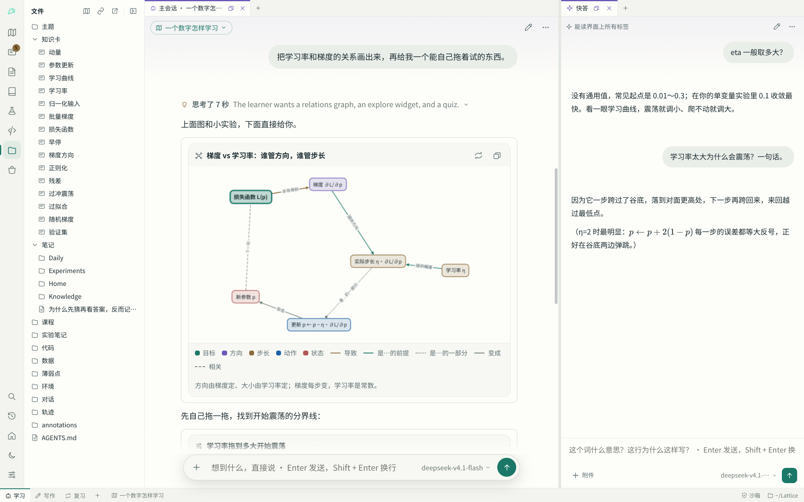

这个版本重新整理了界面：一切都是标签页，左栏只负责浏览和打开，底栏负责切换窗口组合。同时加入了读电子书和批注，并修掉了一个会丢对话的问题。

## 安装

- **Windows**：下载 `Lattice-0.2.0-setup.exe` 安装，或者下载 `Lattice-0.2.0-windows-x64.zip` 解压后运行 `Lattice.exe`。安装包没有代码签名，第一次运行时 SmartScreen 会拦一下：点「更多信息」→「仍要运行」。
- **Linux**：从源码运行，见 [README 的快速开始](https://github.com/vimalinx/lattice#快速开始)。

## 新界面：标签页、左栏和工作状态

- **左栏不再换掉整个界面。** 活动栏的图标只换左栏里的列表，主体的窗口一动不动，开着主会话也能翻文件夹、笔记和知识卡。
- **工作状态。** 底栏的每个标签是一套窗口组合：学习、写作、复习、阅读……切走时原样留着，切回来还是那样。它只管窗口，左栏、外观和学习主题不跟着变。
- **写作模板。** 一大块笔记，旁边是大纲与链接，没有 AI，想专心写的时候用。
- **模板和当前界面分开。** 底栏的「＋」从模板或空白新建，之后怎么改都不影响模板。标签上右键能改名、复制、存成自己的模板、关闭；关闭不会丢布局，随时能重新打开。
- **在工作状态之间传窗口。** 鼠标停在底栏标签上，会列出里面的窗口，点一下就跳过去；拖到别的标签上是移动，按住 Ctrl 拖是复制，拖动时经过哪个标签就显示哪个的列表。
- **AI 不再动你眼前的界面。** 你切走以后，它打开或摆放的窗口留在原来的工作状态里，答完时底栏的标签上亮一个点。

- **回复里的文件名能点。** AI 提到的文件只要确实存在，就显示成带下划线的链接，点一下打开。

## 读书和批注

- **在 Lattice 里读电子书**：PDF、EPUB、MOBI、AZW3、FB2、CBZ 都能直接打开，有目录和全书搜索，关掉再开回到上次的位置。书没打开时 AI 也能按页或按章读。
- **批注**：在书、笔记、代码、实验笔记、网页和对话里选中文字，就能高亮或写批注。所有批注集中在「批注」窗口，能搜索，点一下回到原处，也能做成带出处的知识卡。
- **AI 也会批注**：讲到原文时它会在旁边留批注，你可以撤销；不想要的话跟它说一声，或者在设置里改成只在你要求时才留。
- **问过的话留在原处**：选中文字问快答后，那段话变成带下划线的挂载点，快答关了也还在，点开就能看问答。

## 修复

- **对话不会再丢。** 现在 AI 运行命令之前，会先把对话和学习轨迹存进学习库的历史；就算之后的检查判断失误、把文件退回上一次提交，也丢不了这些内容。
- **改标题后文件名立刻跟上。** 文件本来就会跟着标题改名，但标签、路径栏和左栏还显示旧名字，现在同时更新，也不打断打字。
- **选中文字时，高亮不再超出正文两边。** 笔记、知识卡、主题页和技能编辑器都修了。
- 窄左栏里的标题不再折行，空区域里的「不要这一块」按钮恢复了正常样式。

## 改进

- 每轮固定的内容放在请求前面，支持缓存的模型服务能省下这部分用量。
- 思考强度放到了模型名字旁边。
- 布局变化时电子书不再重新加载。

## 升级时会变的地方

- 原来的工作区会自动转换。开着文件的留在底栏，其余收进「＋」的「已关闭」，布局都在。名字换成按用途的「学习」「复习」等，你改过的名字不变。
- **快捷键变了**：Ctrl+1～8 现在换左栏列表，Ctrl+Shift+1～9 切工作状态。
- 左栏的「搜索」列表去掉了，搜索统一用 Ctrl+K。
- 「恢复默认」去掉了，需要原来的样子时从模板新建。

## 已知问题

- Windows 版没有沙箱：AI 的命令和运行用你的权限直接执行（状态栏显示「直接运行」），学习库里的改动照样记进历史、可以撤销。
- Linux 沙箱联网偶尔会卡住一次请求，重试即可。
- 导入目前只支持 ChatGPT 的分享链接。
- 有 DRM 的书打不开；扫描版 PDF 没有文字层，你能看，AI 读不出字。
- Linux 还没有打包好的安装方式。

有问题或建议欢迎在 [Issues](https://github.com/vimalinx/lattice/issues) 里说。
