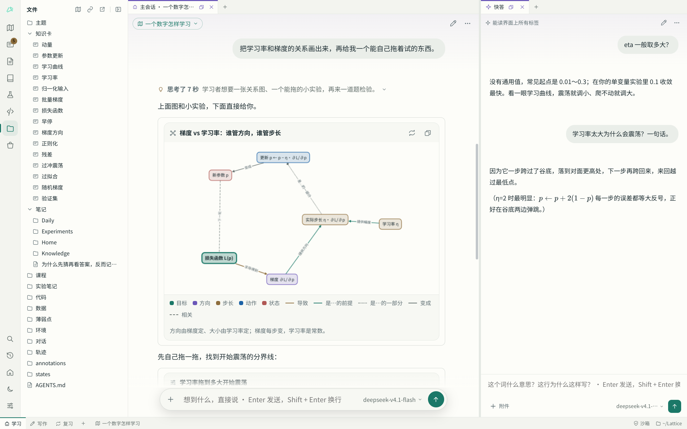
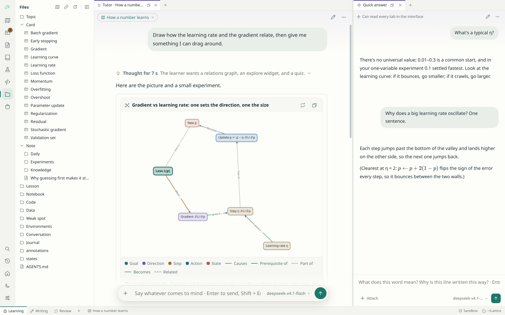

这个版本有了英文界面，工作状态各自独立，可以只用键盘操作，Linux 也有了打包好的版本。

## 安装

- **Windows**：下载 `Lattice-0.3.0-setup.exe` 安装，或者下载 `Lattice-0.3.0-windows-x64.zip` 解压后运行 `Lattice.exe`。安装包没有代码签名，第一次运行时 SmartScreen 会拦一下：点「更多信息」→「仍要运行」。
- **Linux（新）**：下载 `Lattice-0.3.0-linux-x64.tar.gz`，解压后运行里面的 `Lattice`。不用装 Python 和 Qt，但系统里要有 `git`；AI 运行代码和沙箱还需要 [`uv`](https://github.com/astral-sh/uv) 和 `bubblewrap`。它在 Ubuntu 24.04 上构建，需要 glibc 2.39 或更新的发行版。也可以照旧从源码运行，见 [README 的快速开始](https://github.com/vimalinx/lattice#快速开始)。
- **macOS（Apple Silicon 预览版）**：下载 `Lattice-0.3.0-macos-arm64-preview.dmg`，注意事项和 0.2.1 一样，见 [macOS 预览版](https://github.com/vimalinx/lattice#macos-预览版)。

## 英文界面

- 设置的「外观与交互」最上面选「界面语言」：跟随系统、中文、English，重启后生效；也可以用环境变量 `LATTICE_LANG=en`。
- 换的不只是界面上的字：四个 AI 的规则、学习库的规矩和自带的技能也有英文版。
- 已经在用的学习库换语言照常能用。文件夹名（`notes/日记/`、`data/附件/`）和知识卡里「## 我的理解」这一节是文件的格式，不随语言变；你自己起的工作状态名字和改过的规则也保持原样。
- 已经装过 Lattice、从没选过语言的，升级后仍然是中文。

## 每个工作状态像一个单独的程序

- **左栏各记各的。** 学习时开着「文件」，写作时开着「笔记」，复习时开着「知识卡」，切过去就是那样；宽度和收没收起也分开记。
- **快答各有各的。** 在「复习」里问的小问题不会出现在「学习」的快答里，新建或复制一个工作状态也会有一段新的快答。想让同一个快答出现在两边，按住 Ctrl（Mac 上是 Option）把它拖过去。主会话还是同一个。
- **正在学的主题也各记各的。**
- **可以放进单独的窗口。** 底栏标签上右键「放进单独的窗口」，那个窗口就是这个工作状态的完整界面，能拖到另一块屏幕；在里面问的 AI 打开的东西也落在那里，点底栏左下角的 ↩ 放回主窗口。
- **工作状态是学习库里的文件。** 每个存在 `states/<名字>.json`，改名时文件跟着改名，拷到别的学习库也能用。窗口怎么摆单独记进历史，所以撤销 AI 的一步或者你的一次编辑时，窗口不会跟着动。

## 快答能同时回答几个问题

快答正在回答时，可以接着问，最多三个一起答；主会话出的小题也能在它答别的问题时交给它判。每个回答排在它回答的那一问下面，不管哪个先答完。

## 只用键盘也能用

- F6 / Shift+F6 在活动栏、左栏、每组标签和状态栏之间走。
- 在标签上用左右方向键移动，Enter 打开，Delete 关闭；菜单键或 Shift+F10 打开它的菜单，分栏、移到别的工作状态这些原来要拖动才能做的事都在里面。
- 分隔条上用方向键调大小。
- 界面上的按钮、标签和面板都有屏幕阅读器能读出的名字和角色。

## 修复

- **学习库的历史写不进去时会告诉你。** 以前 git 提交失败只写进日志，你不知道之后的改动不能撤销；现在会提示一句（一分钟最多一次）。页面里没接住的错误也会记进日志并提示一次。
- 英文界面下，读电子书时的工具栏（目录、搜索、批注、翻页）和页码也是英文了。

## 改进

- 扫描学习库更快：3000 篇笔记约 6 毫秒，学习库很大时界面不再卡顿。
- 打开窗口、切换工作状态、扫描学习库这些等待的时间可以用 `python3 tests/bench.py` 量。

## 升级时会变的地方

- 原来的工作状态会自动转成 `states/` 里的文件，布局都在。
- 原来那一段共用的快答留给第一个用到它的工作状态，其余的工作状态各开一段新的。
- 原来的左栏变成每个工作状态的起点，之后各改各的。

## 已知问题

- Windows 和 macOS 版没有沙箱：AI 的命令和运行用你的权限直接执行（状态栏显示「直接运行」）。macOS 上默认关闭 AI 运行代码和命令。
- Linux 沙箱联网偶尔会卡住一次请求，重试即可。
- Linux 打包版目前只在 Ubuntu 24.04 上自动验证过能启动，别的发行版还没试过。
- 导入目前只支持 ChatGPT 的分享链接。
- 有 DRM 的书打不开；扫描版 PDF 没有文字层，你能看，AI 读不出字。

有问题或建议欢迎在 [Issues](https://github.com/vimalinx/lattice/issues) 里说。
